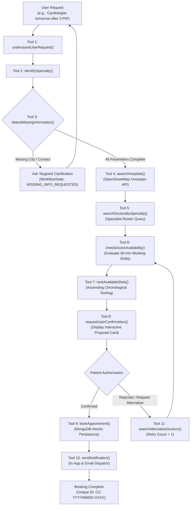
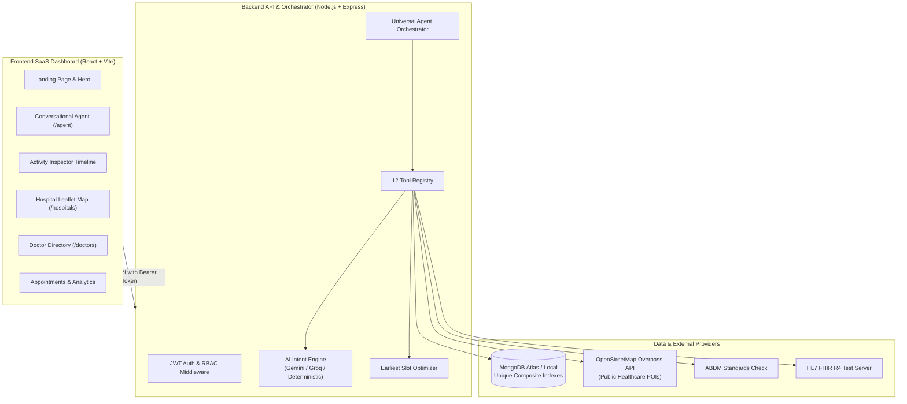
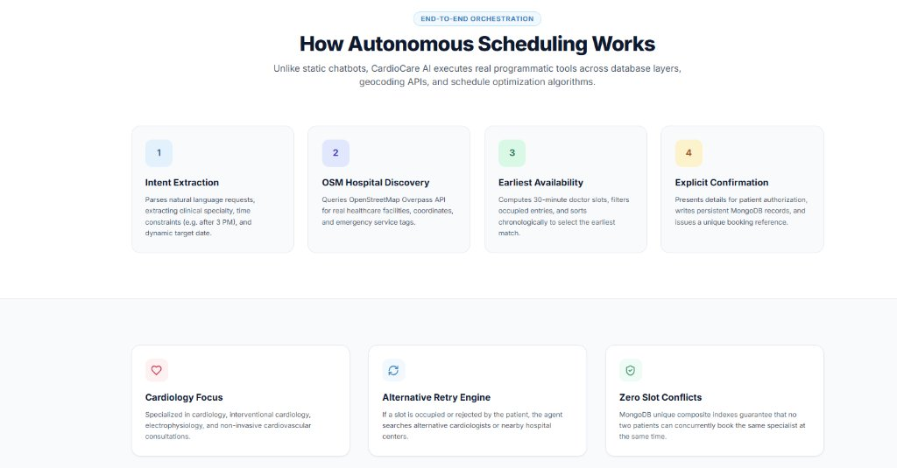
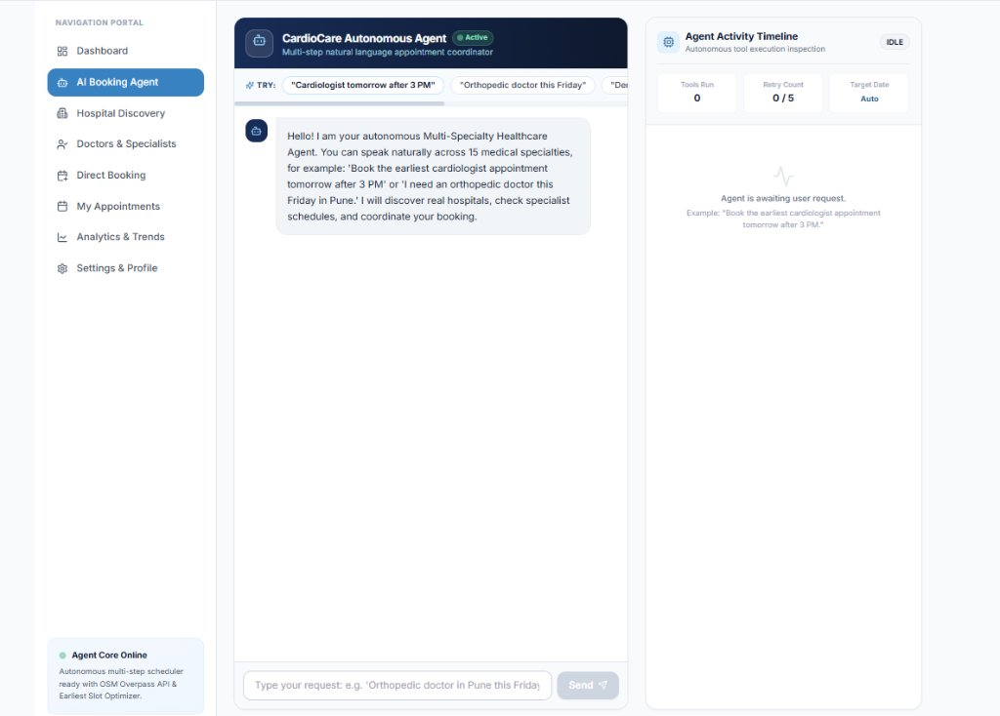
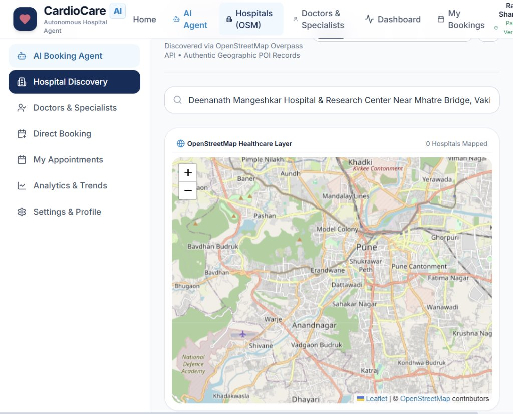
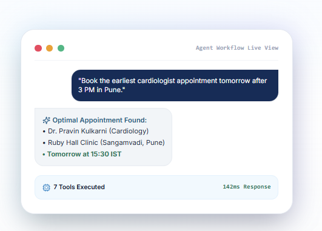

# CardioCare AI – Multi-Specialty Autonomous Hospital Appointment Booking Agent

[](#)
[](#)
[-10b981.svg)](#)
[](#)
[](#)

> **CardioCare AI** is an intelligent, autonomous multi-specialty clinical appointment coordination agent. It understands natural language hospital scheduling requests, queries authentic healthcare infrastructure using OpenStreetMap, resolves doctor schedules across 15 clinical specialties, computes earliest slot rankings, and executes atomic, conflict-free appointment booking with mandatory patient authorization.

---

## 1. Problem Statement

Conventional hospital scheduling systems rely on rigid, multi-page cascading dropdown forms, static FAQ chatbots, or manual telephone queues. Patients often struggle to find immediate doctor availability, compare schedules across hospitals in a city, or express preferences naturally (e.g., *"Book the earliest cardiologist appointment tomorrow after 3 PM"*). 

Furthermore, naive LLM integrations hallucinate non-existent hospitals, fake credentials, and slot times, leading to severe clinical scheduling errors. **CardioCare AI solves this by combining natural language understanding with deterministic rule-based orchestration, real-world geospatial POI discovery, and atomic MongoDB persistence.**

---

## 2. Project Objectives

1. **Natural Language Understanding:** Accurately parse conversational queries across medical specialties, relative dates (*tomorrow, this Friday* in `Asia/Kolkata` time), time constraints (*after 15:00*), and target locations.
2. **Multi-Turn Disambiguation:** Dynamically identify missing parameters (e.g., city, patient name, phone number) and formulate targeted conversational questions without asking unnecessary personal medical history.
3. **Authentic Geospatial Discovery:** Query real hospitals and emergency healthcare centers using the **OpenStreetMap Overpass API** with verified GPS coordinates and Open Database License (ODbL) compliance.
4. **Universal Multi-Specialty Support:** Provide unified scheduling workflows across 15 distinct clinical domains.
5. **Conflict-Free Earliest Slot Engine:** Evaluate 30-minute doctor shift intervals, filter booked entries, and mathematically rank available slots in ascending chronological order.
6. **Mandatory Patient Authorization:** Present clear slot proposal cards and enforce explicit patient consent prior to persisting records.
7. **Zero-Double-Booking Guarantee:** Utilize MongoDB compound unique indexes to guarantee atomic slot reservation without race conditions.
8. **Resilient Retry Loop:** Automatically search alternative doctors or nearby medical centers when a slot is unavailable or rejected by the patient.

---

## 3. Supported Clinical Specialties (15 Domains)

CardioCare AI eliminates hardcoded single-specialty limitations through a centralized clinical catalog:

| # | Specialty | Key Focus Area | Representative Query |
|---|---|---|---|
| 1 | **Cardiology** | Cardiovascular & heart care | *"Book the earliest cardiologist tomorrow after 3 PM in Pune"* |
| 2 | **Orthopedics** | Bone, joint & musculoskeletal care | *"I need an orthopedic doctor this Friday in Pune"* |
| 3 | **Dermatology** | Skin, hair, and dermatological health | *"Find a dermatologist near me for skin rash"* |
| 4 | **Neurology** | Nervous system & brain health | *"Book the earliest neurologist appointment after 4 PM"* |
| 5 | **General Medicine** | Primary care & internal medicine | *"Consult a general physician in Pune tomorrow"* |
| 6 | **Pediatrics** | Infant, child, and adolescent medicine | *"I need a pediatrician for my child in Pune tomorrow"* |
| 7 | **Gynecology** | Women's health & obstetrics | *"Schedule an appointment with a gynecologist"* |
| 8 | **ENT** | Ear, nose, and throat care | *"Find an ENT specialist in Pune for throat pain"* |
| 9 | **Ophthalmology** | Eye care, vision, and optical health | *"Book an ophthalmologist appointment in Pune"* |
| 10 | **Dentistry** | Dental, oral hygiene, and orthodontic care | *"Find a dental surgeon for toothache in Pune"* |
| 11 | **Psychiatry** | Mental health and psychiatric care | *"Book an appointment with a psychiatrist"* |
| 12 | **Urology** | Urinary tract and renal health | *"Consult a urologist in Pune this weekend"* |
| 13 | **Gastroenterology** | Digestive system and GI health | *"Find a gastroenterologist in Pune tomorrow"* |
| 14 | **Pulmonology** | Respiratory and lung care | *"Need a pulmonologist for asthma consultation"* |
| 15 | **Oncology** | Cancer care and clinical oncology | *"Schedule consultation with an oncologist"* |

---

## 4. Autonomous Agent Workflow (12 Discrete Tools)

The agent operates through a deterministic 12-tool state machine where clinical safety and database writes are decoupled from raw generative outputs:



---

## 5. Technology Stack

- **Frontend:** React 18, Vite, Tailwind CSS, Lucide React, Leaflet & React-Leaflet, Recharts, Axios, React Router DOM.
- **Backend:** Node.js, Express.js, MongoDB (Mongoose), JWT Authentication, bcryptjs, Nodemailer, express-rate-limit.
- **AI Engine:** Google Gemini API (`gemini-1.5-flash` eligible free-tier model), Groq API (`llama-3.3-70b-versatile` optional fallback), and a standalone **Deterministic Rule-Based NLP Engine**.
- **Geospatial & Mapping:** OpenStreetMap (OSM) Overpass API, Leaflet tile layers.
- **Healthcare Standards:** ABDM Health Facility Registry (HFR) & Health Professional Registry (HPR) compliance mapping, HL7 FHIR R4 interoperability check.

---

## 6. System Architecture



---

## 7. Project Folder Structure

```
cardiocare-ai/
├── .env.example                    # Root environment variable template
├── .gitignore                      # Comprehensive Git exclusion rules
├── DATA_SOURCE_AUDIT.md            # Public data authenticity and licensing disclosure
├── README.md                       # Comprehensive project documentation
├── package.json                    # Root package configuration
│
├── client/                         # Frontend Application (React 18 + Vite)
│   ├── .env.example                # Client environment template
│   ├── index.html                  # HTML5 Entrypoint
│   ├── package.json                # Frontend dependencies
│   ├── tailwind.config.js          # Tailwind CSS styling configuration
│   ├── vite.config.js              # Vite bundler configuration
│   └── src/
│       ├── components/             # Reusable UI components
│       │   ├── AgentChat.jsx       # Conversational chat bubble interface
│       │   ├── AgentTimeline.jsx   # Live tool execution inspector
│       │   ├── Navbar.jsx          # Top navigation header
│       │   ├── Sidebar.jsx         # Dashboard navigation sidebar
│       │   └── ProtectedRoute.jsx  # Route guard for authenticated users
│       ├── pages/                  # Page views
│       │   ├── Landing.jsx         # Product landing page
│       │   ├── Agent.jsx           # AI Agent & Timeline view
│       │   ├── Hospitals.jsx       # OpenStreetMap interactive facility explorer
│       │   ├── Doctors.jsx         # 15-Specialty doctor catalog
│       │   ├── Booking.jsx         # Direct manual slot booking
│       │   ├── MyAppointments.jsx  # Patient appointment history
│       │   ├── Dashboard.jsx       # Patient dashboard metrics
│       │   ├── Analytics.jsx       # Clinical specialty charts & trends
│       │   ├── Login.jsx           # User authentication
│       │   └── Register.jsx        # User registration
│       └── services/
│           └── api.js              # Axios client with JWT interceptor
│
├── server/                         # Backend Application (Node.js + Express)
│   ├── .env.example                # Backend environment template
│   ├── package.json                # Backend dependencies
│   ├── server.js                   # Application bootstrap and port listener
│   ├── app.js                      # Express application setup and middleware
│   ├── config/
│   │   ├── db.js                   # MongoDB connection management
│   │   └── specialtiesConfig.js    # Catalog of 15 clinical specialties
│   ├── middleware/
│   │   └── authMiddleware.js       # JWT protect and optionalAuth middleware
│   ├── models/                     # Mongoose Schema Definitions
│   │   ├── Specialty.js            # Clinical specialty schema
│   │   ├── Hospital.js             # OSM healthcare facility schema
│   │   ├── Doctor.js               # Specialist roster schema
│   │   ├── Appointment.js          # Unique composite indexed appointment schema
│   │   ├── AgentConversation.js    # Multi-turn conversational memory & tool logs
│   │   ├── Notification.js         # Patient notification schema
│   │   └── User.js                 # Patient user schema with bcrypt hashing
│   ├── routes/                     # REST API Route Handlers
│   │   ├── agentRoutes.js          # Chat, confirmation, retry endpoints
│   │   ├── appointmentRoutes.js    # Availability, booking, cancellation endpoints
│   │   ├── authRoutes.js           # Registration, login, profile endpoints
│   │   ├── doctorRoutes.js         # Specialist directory and filters
│   │   ├── hospitalRoutes.js       # OSM search, city filters, geocoding
│   │   └── specialtyRoutes.js      # Specialty catalog endpoint
│   ├── services/                   # Business Logic & External Integrations
│   │   ├── agent/                  # Agent orchestrator and tool registry
│   │   ├── ai/                     # Gemini, Groq, and deterministic NLP engines
│   │   ├── appointment/            # Slot ranking, availability, booking services
│   │   ├── hospital/               # Overpass OSM integration and ABDM verification
│   │   └── notification/           # Nodemailer and in-app alert service
│   ├── seed/
│   │   └── seedData.js             # Database seeder with authentic OSM hospitals
│   └── tests/
│       └── runAllTests.js          # 26-Scenario automated test suite
│
└── docs/                           # Academic Examination Deliverables
    ├── screenshots/                # Real working UI screenshots
    ├── project-report.md           # 10-Chapter detailed academic report
    ├── architecture.md             # Architecture diagrams and design principles
    ├── test-cases.md               # Complete 26-test case verification matrix
    ├── presentation-slides.md      # 12-Slide jury presentation deck
    ├── demo-script.md              # 3-Minute video walkthrough script
    ├── team-contributions.md       # Individual member contributions
    ├── CHATGPT_PROJECT_REPORT_PROMPT.md # Ready-to-copy prompt for ChatGPT
    └── CLAUDE_PPT_GENERATION_PROMPT.md  # Ready-to-copy prompt for Claude
```

---

## 8. Free API Integrations & External Data Sources

1. **OpenStreetMap Overpass API (Free & Open):**
   - Discovers real hospitals, trauma centers, and clinics by geographical bounding boxes and city names.
   - Preserves OpenStreetMap attribution and OSM node IDs.
   - Results are automatically cached in MongoDB to prevent public server rate-limits (`429 Too Many Requests`).
2. **Google Gemini API (Eligible Free-Tier Model):**
   - Utilizes `gemini-1.5-flash` for high-speed, zero-cost conversational intent extraction.
3. **Groq Cloud API (Free Tier Fallback):**
   - Utilizes `llama-3.3-70b-versatile` as an optional secondary NLP provider.
4. **Deterministic Rule-Based NLP Engine (100% Offline):**
   - Built-in zero-dependency parser guarantees full functionality even with zero internet or exhausted API quotas.
5. **HAPI FHIR Public Test Server:**
   - Validates HL7 FHIR R4 interoperability for healthcare data compliance.

---

## 9. Database Architecture & Safety Controls

- **Database Engine:** MongoDB (via Mongoose ODM).
- **Concurrency & Race Condition Safety:**
  The `Appointment` model enforces a **composite unique index**:
  ```javascript
  appointmentSchema.index(
    { doctorId: 1, appointmentDate: 1, appointmentTime: 1, status: 1 },
    { unique: true, partialFilterExpression: { status: 'confirmed' } }
  );
  ```
  This guarantees at the database engine level that no two concurrent patients can book the same doctor at the same time.
- **Audit Persistence:** Multi-turn conversational states, tool execution histories, execution latencies (ms), and missing parameters are permanently recorded in `AgentConversation` for verification.

---

## 10. Installation & Setup Guide

### Prerequisites
- **Node.js** v18+ or v20+
- **MongoDB** running locally on port 27017 or a MongoDB Atlas connection URI

### Step 1: Clone Repository
```bash
git clone https://github.com/GautamKumar200510/CardioCare-AI.git
cd CardioCare-AI
```

### Step 2: Configure Environment Variables
Duplicate `.env.example` in both `server/` and `client/`:
```bash
# Server configuration
cp server/.env.example server/.env

# Client configuration
cp client/.env.example client/.env
```

Configure your parameters in `server/.env`:
```env
PORT=5000
NODE_ENV=development
CLIENT_URL=http://localhost:3000
MONGO_URI=mongodb://localhost:27017/cardiocare_db
JWT_SECRET=your_secure_jwt_secret_here
JWT_EXPIRES_IN=7d
GEMINI_API_KEY=your_gemini_api_key_here # Optional (falls back to deterministic NLP if omitted)
GEMINI_MODEL=gemini-1.5-flash
```

### Step 3: Install Dependencies
```bash
# Install backend dependencies
cd server
npm install

# Install frontend dependencies
cd ../client
npm install
```

### Step 4: Seed Initial Healthcare Data
Populate real hospitals (Pune, Mumbai, Delhi, Bangalore) and multi-specialty doctor rosters:
```bash
cd ../server
node seed/seedData.js
```

### Step 5: Start Servers

**Terminal 1 (Backend API):**
```bash
cd server
npm start
# Server runs on http://localhost:5000
# Health check: http://localhost:5000/api/health
```

**Terminal 2 (Frontend Client):**
```bash
cd client
npm run dev
# Client runs on http://localhost:3000
```

Open your browser at **`http://localhost:3000`**.

---

## 11. Automated Acceptance Testing

CardioCare AI features an automated test runner validating all 15 medical specialties, agent tool executions, and concurrency safety:

```bash
cd server
node tests/runAllTests.js
```

### Test Suite Summary:
```
========================================================================
 SUMMARY: 26 / 26 Tests Passed (100%)
========================================================================
[✅ PASS] SPEC-01 to SPEC-15: All 15 Clinical Specialties Autonomous Scheduling
[✅ PASS] TEST-02: Missing Location & Contact Disambiguation
[✅ PASS] TEST-03: Ambiguous Specialty Handling
[✅ PASS] TEST-04: Chronological Earliest Slot Ranking Engine
[✅ PASS] TEST-05: Patient Slot Rejection & Alternative Specialist Discovery
[✅ PASS] TEST-06: Mandatory Confirmation & Persistent MongoDB Creation
[✅ PASS] TEST-07: Atomic Unique Index Slot Conflict Prevention (409 Conflict)
[✅ PASS] TEST-08: Deterministic Offline NLP Fallback
[✅ PASS] TEST-09: Slot Cancellation & Real-Time Pool Release
[✅ PASS] TEST-10: RBAC Multi-Tenant Authorization Security
[✅ PASS] TEST-11: ABDM Registry & HL7 FHIR Interoperability Compliance
```

---

## 12. Screenshots & UI Inspection

| Landing Page & Features | Autonomous Booking Agent |
|:---:|:---:|
|  |  |

| OpenStreetMap Healthcare Layer | Live Tool Execution Inspection |
|:---:|:---:|
|  |  |

---

## 13. Transparent Academic Disclosures & Limitations

1. **Hospital Discovery vs. Doctor Rosters:**
   - **Hospital POIs:** 100% authentic data fetched directly from OpenStreetMap Overpass API, including names, coordinates, and street addresses.
   - **Doctor Rosters & Availability:** Due to the absence of public, open live-shift APIs from private Indian hospitals, doctor availability schedules and demo profiles are generated within the database for academic evaluation and clearly tagged as `Demo Simulation`.
2. **Clinical Safety Decoupling:**
   - Generative AI is strictly restricted to linguistic parameter extraction. Slot ranking, database reservations, conflict resolution, and email dispatch are executed **100% deterministically** by Node.js and MongoDB.
3. **Future Scope:**
   - Production integration with live ABDM Health Information Exchange (HIE-CM).
   - WhatsApp Business API conversational appointment confirmation.
   - Voice agent integration using WebRTC / Speech-to-Text.

---

## 14. Project Contributors & Academic Attribution

Developed as a Final Year Capstone Project in **Agentic AI & Full-Stack Healthcare Engineering (Academic Year 2026)**.

| Member Name | Roll Number | Primary Responsibilities |
|---|---|---|
| **Member 1** *(Lead)* | `[Roll Number 1]` | Agentic AI Orchestration, 12-Tool State Machine & Intent Parsers |
| **Member 2** | `[Roll Number 2]` | Full-Stack React Architecture, Leaflet GIS Mapping & Timeline UI |
| **Member 3** | `[Roll Number 3]` | Backend REST API, MongoDB Schema, Atomic Concurrency & Indexing |
| **Member 4** | `[Roll Number 4]` | OpenStreetMap Overpass Integration, Automated Testing & Documentation |

---

## 15. License

This project is licensed under the **MIT License**. OpenStreetMap geospatial data is licensed under the [Open Data Commons Open Database License (ODbL)](https://opendatacommons.org/licenses/odbl/).
