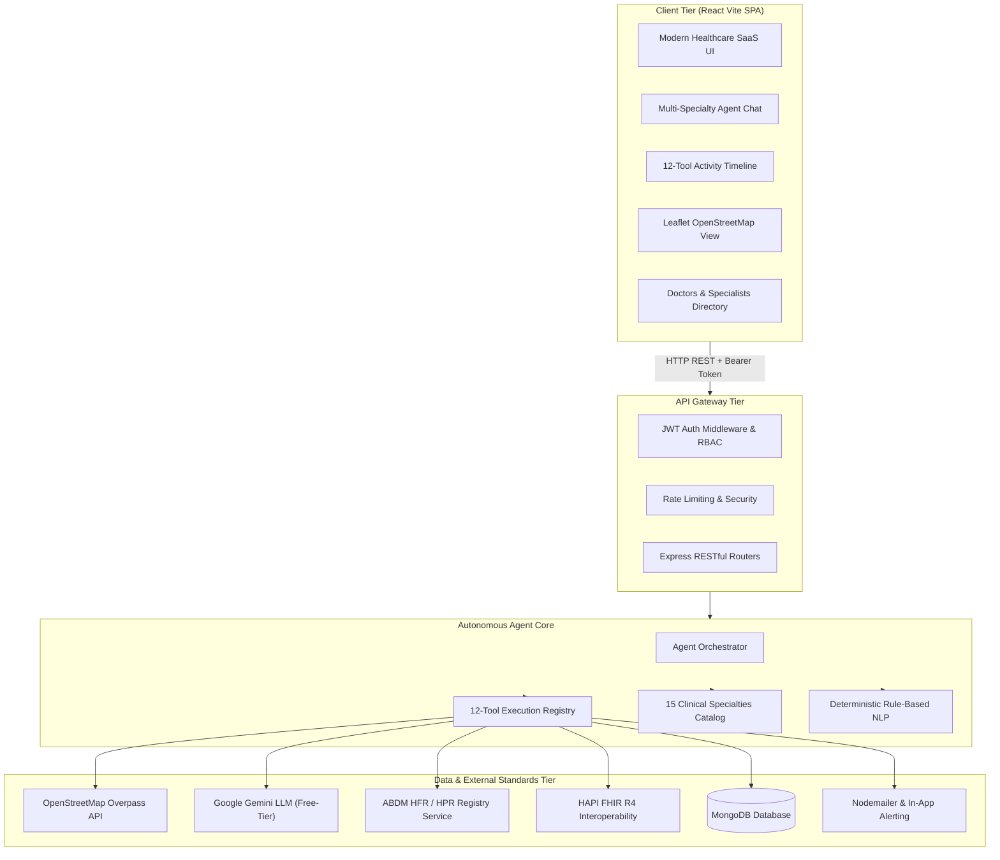
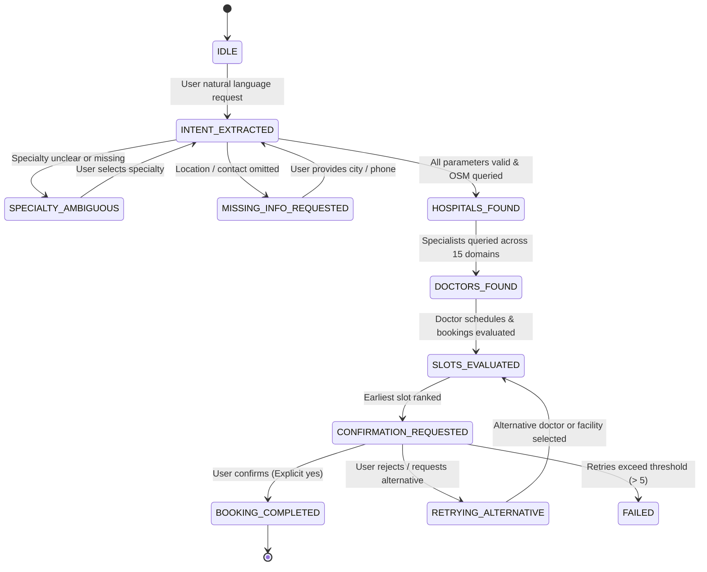
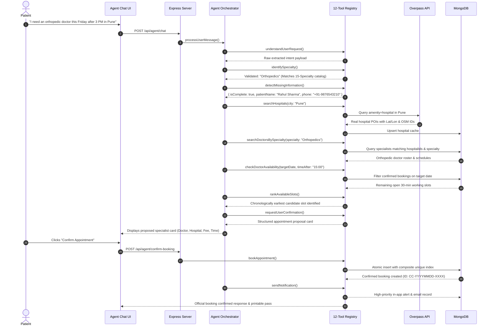

# CardioCare AI – Multi-Specialty Architecture & Technical Specifications

## 1. High-Level Architecture Overview

CardioCare AI combines a **Modern React Single Page Application (SPA)** with an **Autonomous Multi-Specialty Agent Engine** powered by Google Gemini, deterministic NLP orchestration, OpenStreetMap healthcare discovery, ABDM registry verification, and HL7 FHIR R4 interoperability.



---

## 2. Agent Finite State Machine (Workflow States)

The autonomous multi-specialty agent operates as a deterministic finite-state automaton with 11 distinct states:



---

## 3. Sequence Diagram: 12-Tool Multi-Specialty Booking Flow



---

## 4. The 12-Tool Execution Registry

Every clinical action is encapsulated as a discrete, deterministic tool registered in `server/services/agent/toolRegistry.js`:

| Tool Name | Input Parameters | Output Payload | Description |
| :--- | :--- | :--- | :--- |
| `understandUserRequest` | `userMessage`, `conversationContext` | `{ intent, rawSpecialty, dateStr, timeConstraint, ... }` | Dual-mode parsing via Gemini LLM or deterministic regex engine. |
| `identifySpecialty` | `rawText`, `extractedSpecialty` | `{ specialty, slug, isSupported, canonicalName }` | Validates against 15 supported medical specialties. |
| `detectMissingInformation` | `extractedData`, `userContext` | `{ isComplete, missingFields, followUpPrompt }` | Flags missing location or contact; prevents irrelevant medical questions. |
| `searchHospitals` | `city`, `area`, `limit` | `{ count, hospitals: [...] }` | Queries OpenStreetMap Overpass API and caches facilities in MongoDB. |
| `searchDoctorsBySpecialty` | `specialty`, `hospitalIds`, `city` | `{ count, doctors: [...] }` | Retrieves specialist rosters across verified and demo tiers. |
| `checkDoctorAvailability` | `doctorId`, `targetDate`, `timeAfter` | `{ availableSlots: [...], bookedSlots: [...] }` | Subtracts occupied bookings from 30-minute working shift intervals. |
| `rankAvailableSlots` | `candidateSlots`, `preference` | `{ selectedSlot, sortedCount }` | Chronologically sorts candidate slots ascending and surfaces the earliest. |
| `requestUserConfirmation` | `candidateSlot`, `patientDetails` | `{ confirmationRequired: true, slotCard: {...} }` | Formulates structured booking card requiring patient authorization. |
| `bookAppointment` | `slotData`, `patientId`, `patientDetails`| `{ bookingId, appointment: {...} }` | Commits atomic record in MongoDB with double-booking prevention. |
| `sendNotification` | `appointment`, `patient` | `{ emailSent, inAppAlertCreated }` | Dispatches email notification and generates verified in-app alert. |
| `searchAlternativeDoctors` | `specialty`, `city`, `excludedIds` | `{ alternativeDoctors: [...] }` | Identifies secondary specialists or alternate hospitals on rejection. |
| `retryAppointmentSearch` | `context`, `rejectedSlot` | `{ nextSlot, retryCount }` | Manages retry state and enforces safety ceiling ($n \le 5$). |

---

## 5. Universal Appointment Booking Engine

The universal appointment engine replaces legacy single-specialty booking:
1. **Dynamic Schedule Calculation:** Each specialist maintains working shifts (e.g., Mon–Sat, 09:00–17:00). Slots are calculated dynamically in 30-minute intervals.
2. **Occupancy Filtering:** Existing bookings on the target date with status `confirmed` are retrieved and excluded from available options.
3. **Double-Booking Prevention:** A partial composite unique index in MongoDB enforces database-level concurrency protection:
   ```javascript
   appointmentSchema.index(
     { doctorId: 1, appointmentDate: 1, appointmentTime: 1, status: 1 },
     { unique: true, partialFilterExpression: { status: 'confirmed' } }
   );
   ```
4. **Transparent Verification Hierarchy:**
   - **Verified Doctors:** Doctors with verified credentials linked to real facilities.
   - **Demo Simulation Doctors:** Clearly marked sample profiles ensuring zero fraudulent academic claims.

---

## 6. External Standards & Data Integrations

1. **OpenStreetMap Overpass API:** Live geospatial queries for hospitals and healthcare centers with latitude, longitude, and emergency tags.
2. **National Health Authority (ABDM):**
   - **Health Facility Registry (HFR):** Public facility ID validation (`IN.XX.YYY.NNNNN`) and portal inspection link generation.
   - **Healthcare Professionals Registry (HPR):** Practitioner ID format verification.
3. **HL7 FHIR R4 Standards:**
   - Standardized mapping of Doctor $\rightarrow$ `Practitioner`, Hospital $\rightarrow$ `Organization`, Appointment $\rightarrow$ `Appointment`.
   - Live connectivity and interoperability evaluation against public test server `https://hapi.fhir.org/baseR4`.
